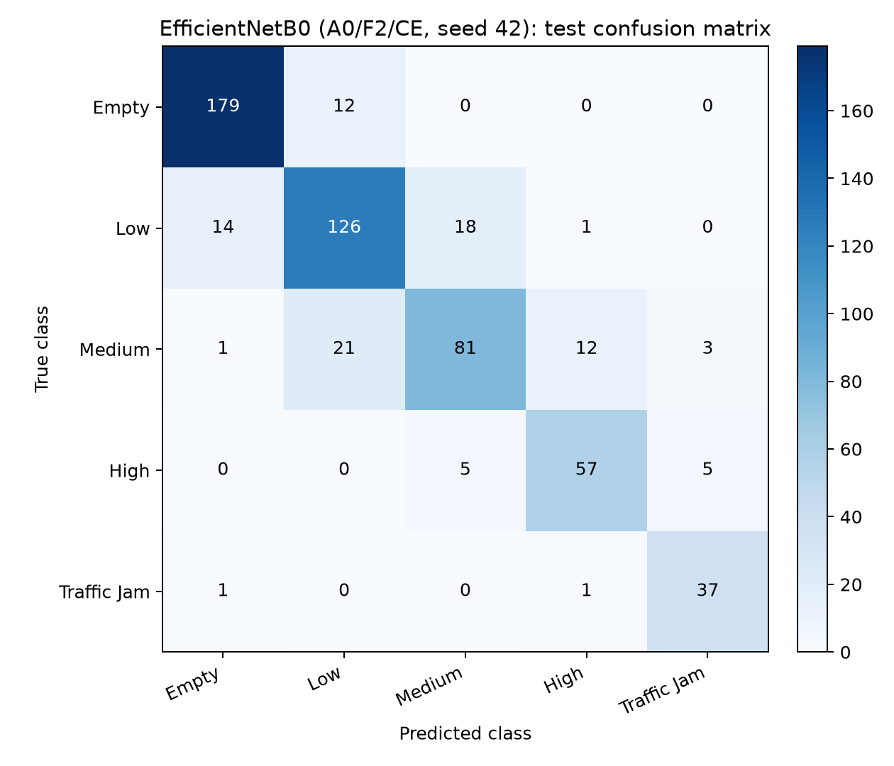
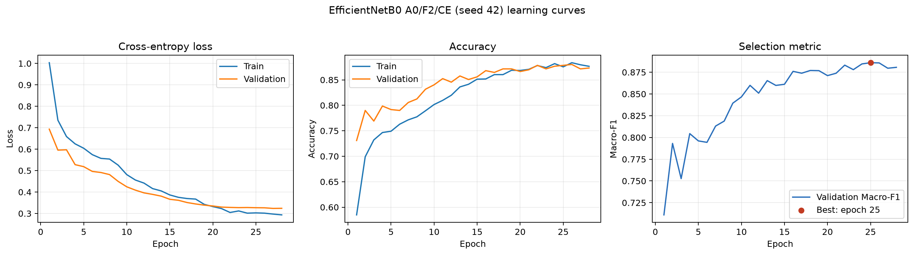

# IV. Experimental Results

## 4.1 Experimental Setup

The reproducible final Complex CNN and transfer-learning experiments use the derived manifests in `data/transfer_final_manifests/`: 2,691 training, 576 validation, and 574 test images. These manifests were derived from the clean 2,707/580/581 split after excluding 27 image records associated with verified Category-A near-duplicate candidates (16 train, 4 validation, and 7 test records). The class order was `Empty=0`, `Low=1`, `Medium=2`, `High=3`, and `Traffic Jam=4`.

Images are decoded as RGB and resized with aspect-ratio-preserving 224 x 224 letterboxing. The transfer loader uses an RGB padding colour of `(124, 116, 103)` and reads the same saved manifests for train, validation, and test. Transfer backbones use their Keras ImageNet-compatible preprocessing in the model graph. The development metric was validation Macro-F1; all transfer configuration decisions were made on validation data before final test evaluation. The transfer runner uses AdamW, an initial frozen-backbone stage, fine-tuning where applicable, checkpointing on validation Macro-F1, and early stopping. The Complex CNN runner used Adam with a 64-image batch size and 20 epochs; its experiment selection was also based on validation Macro-F1, with validation accuracy and loss as tie-breakers.

All final numbers below are identified as validation or test results. In particular, validation Macro-F1 is not presented as final test performance.

## 4.2 Ablation Studies

The following ablations use EfficientNetB0 with seed 42. Reported validation accuracy is the value at the epoch with the best validation Macro-F1, rather than the maximum accuracy from a different epoch.

### Augmentation ablation

| Augmentation | Validation Accuracy | Validation Macro-F1 | Best epoch |
|---|---:|---:|---:|
| A0: none | 0.8715 | **0.8785** | 18 |
| A1: mild | 0.8455 | 0.8584 | 28 |
| A2: stronger | 0.8385 | 0.8504 | 21 |

With the other settings fixed at F1 and weighted cross-entropy, no augmentation (A0) was clearly best. Both A1 and A2 reduced validation Macro-F1 by 0.0201 and 0.0281, respectively, relative to A0. This suggests that the implemented geometric and photometric transformations did not match the source traffic-camera distribution closely enough, or altered visual density cues that the model needed for discrimination. This finding is empirical for this dataset and does not imply that augmentation is generally harmful.

### Fine-tuning ablation

| Strategy | Description | Validation Accuracy | Validation Macro-F1 |
|---|---|---:|---:|
| F0 | Frozen backbone | 0.8003 | 0.8001 |
| F1 | Fine-tune final 25% of backbone layers | 0.8715 | 0.8785 |
| F2 | Fine-tune final 50% of backbone layers | **0.8733** | **0.8819** |

These runs used A0 and weighted cross-entropy. Fine-tuning substantially improved Macro-F1 over the frozen backbone (+0.0817 for F2), indicating that ImageNet features benefited from adaptation to traffic-density imagery. The incremental difference from F1 to F2 was modest (+0.0033 Macro-F1), but deeper fine-tuning was retained for the subsequent loss ablation.

### Loss ablation

| Loss | Validation Accuracy | Validation Macro-F1 | Best epoch |
|---|---:|---:|---:|
| Ordinary categorical cross-entropy (CE) | **0.8785** | **0.8860** | 25 |
| Weighted CE | 0.8733 | 0.8819 | 21 |
| Weighted CE + label smoothing (0.05) | 0.8698 | 0.8782 | 27 |

Under A0/F2, ordinary CE was selected by validation Macro-F1. Although the data are imbalanced, class weighting did not improve Macro-F1 in this one-seed ablation. A plausible interpretation is that stronger emphasis on rarer classes traded away discrimination among the larger adjacent classes; it should not be interpreted as evidence that weighting is universally unsuitable.

## 4.3 Main Model Comparison

Table 4.1 separates the assignment model categories and marks the only non-comparable result. The Simple CNN artifacts use a distinct 587-sample legacy test protocol and do not persist a manifest reference or parameter count. They therefore provide useful historical context but must not be used to rank models against the 574-sample final-clean-manifest runs.

| Model category | Model / configuration | Test split | Accuracy | Macro Precision | Macro Recall | Macro-F1 | Weighted F1 | Balanced Accuracy | Parameters | Comparability |
|---|---|---:|---:|---:|---:|---:|---:|---:|---:|---|
| Simple CNN | A1 + weighted CE, seeds 42/43/44 | 587, legacy | 0.6826 +/- 0.0494 | 0.6639 +/- 0.0546 | 0.7151 +/- 0.0314 | 0.6787 +/- 0.0488 | 0.6814 +/- 0.0533 | 0.7151 +/- 0.0314 | Not recorded | Not directly comparable |
| Complex CNN | Deep CNN baseline, selected on validation | 574, final clean | 0.7648 | 0.7781 | 0.7639 | 0.7669 | Not recorded | 0.7639 | 617,829 | Comparable |
| Transfer learning | EfficientNetB0, A0/F2/CE, seed 42 | 574, final clean | 0.8362 | 0.8229 | 0.8431 | **0.8313** | 0.8344 | 0.8431 | 4,055,976 | Comparable |

On the final clean test manifest, the selected EfficientNetB0 improved Macro-F1 by 0.0645 over the selected Complex CNN. The legacy Simple CNN value is lower, but it cannot support a formal three-way ranking because it was evaluated on a different, undocumented-in-artifact test protocol. The comparison therefore supports the transfer-learning result over the Complex CNN under the final protocol, while a final Simple CNN evaluation on the same 574-image manifest remains outstanding.

The final transfer-backbone comparison used the validation-selected A0/F2/CE configuration and seed 42.

| Transfer backbone | Parameters | Test Accuracy | Macro Precision | Macro Recall | Macro-F1 | Weighted F1 | Balanced Accuracy |
|---|---:|---:|---:|---:|---:|---:|---:|
| MobileNetV2 | 2,264,389 | 0.8136 | 0.7999 | 0.8120 | 0.8029 | 0.8100 | 0.8120 |
| EfficientNetB0 | 4,055,976 | 0.8362 | 0.8229 | **0.8431** | **0.8313** | 0.8344 | **0.8431** |
| ResNet50 | 23,597,957 | **0.8380** | **0.8259** | 0.8366 | 0.8306 | **0.8364** | 0.8366 |

EfficientNetB0 had the highest test Macro-F1, whereas ResNet50 had marginally higher accuracy (+0.0017). The Macro-F1 difference between EfficientNetB0 and ResNet50 was only 0.0008, so this is a small practical difference on this test set. MobileNetV2 was less accurate but used roughly 44% fewer parameters than EfficientNetB0 and about one tenth of the ResNet50 parameter count, making it the clearest efficiency-oriented alternative.

### Multi-seed check for the selected transfer configuration

For EfficientNetB0 A0/F2/CE, validation Macro-F1 across seeds 42/43/44 was **0.8858 +/- 0.0018** (sample standard deviation). Test Macro-F1 was 0.8313, 0.8305, and 0.8325, respectively (mean 0.8314 +/- 0.0010). Test accuracy was exactly 0.8362 for all three runs because each produced 480 correct predictions out of 574; however, their saved confusion matrices and per-class metrics differ. Thus the artifacts are consistent with separate model evaluations rather than a copied prediction vector, although raw per-sample test predictions were not retained for an additional audit.

## 4.4 Per-Class Performance

Table 4.2 reports the final test performance of the validation-selected EfficientNetB0 configuration (A0/F2/CE, seed 42). `Traffic Jam` has the smallest support (39 images), so its apparently high recall should be interpreted with that sample size in mind.

| Class | Support | Precision | Recall | F1 |
|---|---:|---:|---:|---:|
| Empty | 191 | 0.9179 | 0.9372 | **0.9275** |
| Low | 159 | 0.7925 | 0.7925 | 0.7925 |
| Medium | 118 | 0.7788 | 0.6864 | **0.7297** |
| High | 67 | 0.8028 | 0.8507 | 0.8261 |
| Traffic Jam | 39 | 0.8222 | 0.9487 | 0.8810 |

`Empty` was the easiest class by F1, followed by `Traffic Jam`. `Medium` was the hardest class, primarily because its recall was 0.6864. The pattern is consistent with the semantic difficulty of assigning a single discrete label to visually continuous traffic density, especially around the Low/Medium and Medium/High boundaries.

## 4.5 Confusion Matrix Analysis

Figure 4.1 is generated directly from the saved test confusion matrix of EfficientNetB0 A0/F2/CE (seed 42).

**Figure 4.1.** Test confusion matrix for EfficientNetB0 A0/F2/CE, seed 42, on the 574-image final clean test manifest. Source: `outputs/transfer_learning/efficientnetb0_A0_F2_ce_s42/test_metrics.json`.

The matrix is strongly diagonal, but the off-diagonal structure is informative. `Empty` was mainly confused with `Low` (12 cases). `Low` was confused with `Empty` (14) and `Medium` (18). `Medium` was most often predicted as `Low` (21) or `High` (12), matching its lower recall. `High` was confused equally with `Medium` and `Traffic Jam` (5 cases each). `Traffic Jam` had only two errors, one each to `Empty` and `High`.

Of the 94 errors, 88 (93.6%) are one-level, adjacent-class errors. The remaining six include one Low-to-High, one Medium-to-Empty, three Medium-to-Traffic Jam, and one Traffic-Jam-to-Empty prediction. Consequently, the dominant failure mode is uncertainty between neighbouring density levels rather than arbitrary class assignment.

## 4.6 Ordinal Analysis

The ordered labels are Empty=0, Low=1, Medium=2, High=3, and Traffic Jam=4. For the selected EfficientNetB0 seed-42 test run, ordinal MAE was **0.1777** and within-one-level accuracy was **0.9895**. In practical terms, nearly all predictions were either correct or within one density level; a High-to-Medium error is less severe than an Empty-to-Traffic-Jam error. These ordinal metrics are directly saved for the transfer runs. The Complex CNN final-test artifact does not save ordinal metrics, so it is not included in this numerical ordinal comparison.

## 4.7 Training Behaviour

Figure 4.2 was generated from the saved history of the selected EfficientNetB0 run. Validation Macro-F1 rose from 0.7110 at epoch 1 to a peak of 0.8860 at epoch 25, then remained near 0.88 through epoch 28. Validation loss also decreased substantially from 0.6933 at the first epoch to 0.3241 by the final epoch. This supports convergence with a late-stage plateau rather than a large late collapse in validation performance.

**Figure 4.2.** Training and validation curves for EfficientNetB0 A0/F2/CE, seed 42. The red marker identifies the epoch selected by validation Macro-F1. Source: `outputs/transfer_learning/efficientnetb0_A0_F2_ce_s42/history.json`.

The Complex CNN baseline curves are also available at `outputs/complex_cnn/exp1_baseline/curves.png`. Direct claims that transfer learning converged faster than the scratch CNN are avoided here because the runs used different model families, epoch schedules, and data-loading implementations.

## 4.8 Grad-CAM and Failure Analysis

No Grad-CAM artifacts, saliency maps, or curated image-level failure-case panels were found in the current repository. Therefore, no claim is made about whether the model attends to vehicles, roads, watermarks, sky, or camera-specific backgrounds. The supported failure analysis is limited to the saved confusion matrix: errors are predominantly adjacent density-level confusions, with `Medium` being the weakest class. Grad-CAM and a reviewed panel of correct and incorrect examples should be added before making visual-attention claims.

## 4.9 Discussion

The selected EfficientNetB0 configuration performed best by the development criterion and achieved the strongest clean-test Macro-F1 among the final transfer backbones. Its pretrained representation, followed by deeper fine-tuning, appears more useful than training the 617,829-parameter custom CNN from scratch on this dataset. Nonetheless, ResNet50 obtained slightly higher accuracy, while EfficientNetB0 obtained slightly higher Macro-F1; the difference is too small to support a strong superiority claim between those two backbones.

The ablations show that the relevant choice was not simply to add more regularisation. The no-augmentation setting outperformed both augmentation strengths, deeper fine-tuning materially outperformed a frozen backbone, and ordinary CE outperformed weighted CE and smoothing on validation Macro-F1. Since these ablations use one seed, they should guide the selected configuration rather than be treated as broad causal laws.

The main error pattern is ordinal and local: Low, Medium, and High are often confused with adjacent density levels. This is aligned with the task definition, where static images encode a continuous and context-dependent notion of density. The high within-one-level accuracy is encouraging, but it does not eliminate the importance of the remaining non-adjacent errors for an operational use case.

Several limitations remain. The dataset is modest in size and imbalanced; class boundaries are ambiguous; images come from heterogeneous traffic-camera sources; and static frames describe visible density rather than traffic speed or flow. Exact duplicates were handled in the clean split and confirmed Category-A near-duplicate records were excluded for the final transfer/Complex manifests, but likely related sequences still require manual review rather than automatic grouping. Finally, the training images are Singapore traffic-camera images, and no Hanoi external dataset has been supplied or evaluated. The current findings should therefore not be presented as deployment or state-of-the-art claims.

### Optional future subsection: Hanoi external inference

No Hanoi images or labels are present in the repository. External inference, calibration, and error analysis for Hanoi are future work and are intentionally not reported as results.

# V. Conclusion

This project investigated five-class traffic-density classification from static traffic-camera images using a Simple CNN, a custom Deep CNN, and ImageNet-pretrained transfer-learning backbones. The reproducible final protocol used RGB, aspect-ratio-preserving 224 x 224 inputs and the saved Category-A-cleaned manifests. Validation Macro-F1, rather than test performance, was used to select the transfer-learning configuration.

The selected final model was EfficientNetB0 with no augmentation, deeper fine-tuning (F2), and ordinary categorical cross-entropy. On the final 574-image clean test manifest, its seed-42 checkpoint achieved **0.8362 accuracy, 0.8229 Macro Precision, 0.8431 Macro Recall, and 0.8313 Macro-F1**. ResNet50 produced marginally higher accuracy (0.8380) but slightly lower Macro-F1 (0.8306), while MobileNetV2 provided a smaller, lower-cost alternative with Macro-F1 of 0.8029. The selected custom Deep CNN reached Macro-F1 of 0.7669 on the same final test manifest.

The most important development findings were that stronger augmentation did not help this dataset, deeper fine-tuning improved substantially over a frozen EfficientNetB0 backbone, and ordinary CE outperformed weighted CE and label smoothing on validation Macro-F1. The final confusion matrix further showed that most remaining mistakes were between neighbouring density levels, especially around `Medium`; 98.95% of EfficientNetB0 predictions were within one ordinal level of the true class.

The legacy Simple CNN artifacts show lower performance, but their 587-sample test protocol is not the final 574-sample clean manifest and lacks a persisted manifest reference. A fair final Simple-versus-Complex-versus-Transfer comparison therefore still requires rerunning or evaluating the Simple CNN checkpoint on the final shared manifest. Future work should add this comparable Simple CNN evaluation, generate Grad-CAM and image-level failure analyses, review likely related image sequences, evaluate on geographically diverse traffic cameras including Hanoi data, and investigate temporal/video information before considering real-time deployment.

## Recommended tables and figures

| Item | Suggested caption | Existing or generated artifact |
|---|---|---|
| Table 4.1 | Final model comparison with split provenance | This document; source files listed in `RESULTS_SOURCE_MAP.md` |
| Table 4.2 | EfficientNetB0 per-class test metrics | This document; `outputs/transfer_learning/efficientnetb0_A0_F2_ce_s42/test_metrics.json` |
| Table 4.3 | Augmentation, fine-tuning, and loss ablations on validation | This document; `outputs/transfer_learning/experiment_registry.csv` and histories |
| Figure 4.1 | EfficientNetB0 final-test confusion matrix | `report/figures/efficientnetb0_a0_f2_ce_s42_test_confusion_matrix.png` |
| Figure 4.2 | EfficientNetB0 selected-run learning curves | `report/figures/efficientnetb0_a0_f2_ce_s42_learning_curves.png` |
| Figure 4.3 | Grad-CAM examples | Not available; future work |
